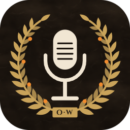

  

<h1 align="center">Only Whispers</h1>

  <em>Hold the Key, speak, and get clean text in any app.</em> 
  <a href="https://only-whispers.bonobo-senate.com"><strong>Website</strong></a> ·
  <a href="https://github.com/raythurnvoid/only-whispers/releases/latest">Releases</a> ·
  <a href="#privacy">Privacy</a>

---

## How it works

1. Hold the Key and speak.
2. Let go.
3. Clean text appears where your cursor is, in any app.

## Install

1. Download the app for your platform from the [website](https://only-whispers.bonobo-senate.com) or the [latest release](https://github.com/raythurnvoid/only-whispers/releases/latest).
2. On the setup screen:
   - Paste a **Mistral API key** ([create one here](https://admin.mistral.ai/organization/api-keys), the free plan works).
   - Click **Sign in with ChatGPT**.

The app updates itself.

**macOS** (preview, Apple Silicon only): open the `.dmg` and drag the app to Applications. The app is not checked by Apple, so macOS blocks the first open: go to System Settings → Privacy & Security and click **Open Anyway**. You do this once; updates open normally.

## Privacy

Your words stay yours.

- We never see your voice or your text. There is no account with us.
- Your voice goes only to the AI services you connect, to turn it into clean text.
- Your history stays on your computer.

## Code signing policy

Free code signing provided by [SignPath.io](https://about.signpath.io/), certificate by [SignPath Foundation](https://signpath.org/).

- Committers and reviewers: [raythurnvoid](https://github.com/raythurnvoid)
- Approvers: [raythurnvoid](https://github.com/raythurnvoid)

## Contributing

See [CONTRIBUTING.md](CONTRIBUTING.md).

## License

Only Whispers is open source under the [MIT License](LICENSE).

Made by Daniele Loreto ([GitHub](https://github.com/raythurnvoid), [LinkedIn](https://www.linkedin.com/in/ray-thurn-void), [X](https://x.com/raythurnvoid)).

Based on [OpenWhispr](https://github.com/OpenWhispr/openwhispr) by Gabriel Stein ([LinkedIn](https://www.linkedin.com/in/gabrielste1n)). The "Sign in with ChatGPT" flow is based on [OpenCode](https://github.com/anomalyco/opencode).
