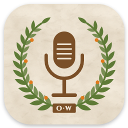

<p align="center">
  
</p>

<h1 align="center">Only Whispers</h1>

<p align="center">
  <em>Hold a key, speak, and get clean text in any app.</em><br/>
  <a href="https://only-whispers.bonobo-senate.com"><strong>Download</strong></a> ·
  <a href="https://github.com/raythurnvoid/only-whispers/releases/latest">Releases</a> ·
  <a href="#privacy">Privacy</a>
</p>

---

## How it works

1. Hold **Ctrl+Win** and speak.
2. Let go.
3. Clean text appears where your cursor is, in any app.

**Mistral Voxtral** turns your voice into text. **OpenAI Luna** removes filler words and fixes grammar and punctuation. If cleanup fails, you get the raw text instead.

## Install (Windows)

1. Download the installer from the [website](https://only-whispers.bonobo-senate.com).
2. Run it. If Windows shows "Windows protected your PC", click **More info**, then **Run anyway**. Signed installers come once [code signing](#code-signing-policy) is approved.
3. On the setup screen:
   - Paste a **Mistral API key** ([create one here](https://admin.mistral.ai/organization/api-keys), the free plan works).
   - Click **Sign in with ChatGPT**. Cleanup runs on your ChatGPT plan, so you need no OpenAI API key.

The app updates itself.

## Cost

- Speech-to-text: about $0.0035 per minute of audio, on your Mistral key.
- Cleanup: included in your ChatGPT plan.

## Limits

- Windows only for now.
- English only for now.

## Privacy

Only Whispers has no server and no account.

- Your audio and your dictionary words go to [Mistral](https://mistral.ai/terms#privacy-policy), with your own key.
- The text goes to [OpenAI](https://openai.com/policies/privacy-policy/), through your own ChatGPT sign-in.
- The app checks GitHub for updates.

Your history and recordings stay on your computer.

## Code signing policy

Free code signing provided by [SignPath.io](https://about.signpath.io/), certificate by [SignPath Foundation](https://signpath.org/).

- Committers and reviewers: [raythurnvoid](https://github.com/raythurnvoid)
- Approvers: [raythurnvoid](https://github.com/raythurnvoid)

## Develop

You need [Git](https://git-scm.com/), [Node.js 24](https://nodejs.org/) and [pnpm](https://pnpm.io/installation).

```bash
git clone https://github.com/raythurnvoid/only-whispers.git
cd only-whispers
pnpm install
pnpm dev
```

Quit the installed app first, so both copies don't react to the hotkey.

| Command                | What it does                                          |
| ---------------------- | ----------------------------------------------------- |
| `pnpm dev`             | Starts the app with hot reload.                       |
| `pnpm test`            | Runs the tests.                                       |
| `pnpm run release:win` | Builds an unsigned installer and publishes a release. |

Signed releases run in GitHub Actions: **Release Windows (signed)**.

## Credits

Made by **Daniele Loreto** ([GitHub](https://github.com/raythurnvoid), [LinkedIn](https://www.linkedin.com/in/ray-thurn-void), [X](https://x.com/raythurnvoid)).

Only Whispers is a fork of [OpenWhispr](https://github.com/OpenWhispr/openwhispr) by Gabriel Stein ([LinkedIn](https://www.linkedin.com/in/gabrielste1n)) and the OpenWhispr team. Thank you!

The "Sign in with ChatGPT" flow is based on [OpenCode](https://github.com/anomalyco/opencode).

MIT License. See [LICENSE](LICENSE).
